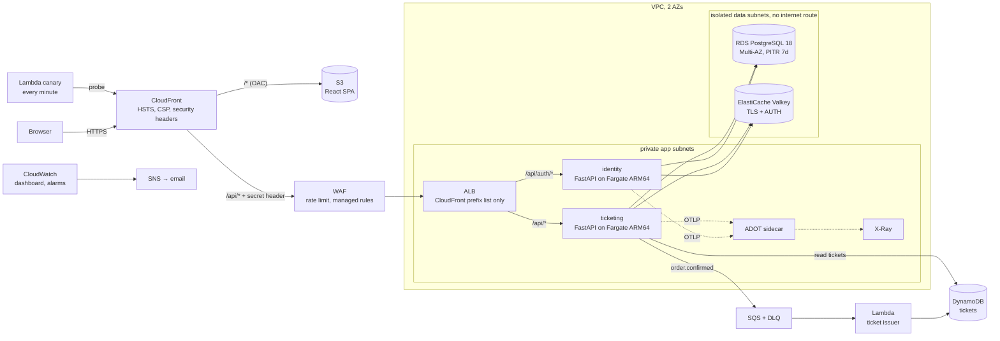

# ⚡ TicketRush

**A flash-sale ticketing platform on AWS that never oversells a seat, even when thousands of people click "Buy" in the same second.**

I wrote two Python microservices, a React SPA and two Lambda functions, and run them on production-style AWS infrastructure that is 100% Terraform: ECS Fargate (Graviton), Multi-AZ RDS PostgreSQL, ElastiCache (Valkey), SQS, DynamoDB, CloudFront, S3 and WAF. Deploys go through GitHub Actions with OIDC (no stored AWS keys), and the platform ships with an SRE dashboard, alarms and runbooks.

> The environment is ephemeral by design: build, demo, measure, `terraform destroy`. Screenshots and measured numbers are in [docs/METRICS.md](docs/METRICS.md).

---

## Why this problem

Ticket drops are a classic distributed-systems interview question. Demand spikes 100x, every request fights over the same rows, and correctness (no oversell, no double charge) matters more than anything else. Each part of the stack below answers a concrete failure mode:

| Problem | Answer in this repo |
|---|---|
| 40 buyers, 10 seats: who wins? | One atomic `UPDATE … SET available = available - n WHERE available >= n` in Postgres, plus a `CHECK (available >= 0)` constraint. **Tested**: 40 concurrent buyers, exactly 10 orders |
| User double-clicks "Buy" / network retry | `Idempotency-Key` header + `UNIQUE(user_id, idempotency_key)`: a retry returns the original order |
| Scalpers buying everything | Per-user cap enforced under a Postgres advisory lock, per-user rate limit in Valkey, WAF rate-based rule per client IP |
| Event pages hammered during the drop | Cache-aside in ElastiCache (Valkey), invalidated on purchase. Fails open to Postgres if the cache dies |
| Ticket issuing must not slow checkout | Order event → SQS → Lambda → DynamoDB, asynchronous, idempotent, with DLQ and partial-batch failure reporting |
| "Is it up *for users*?" | External synthetic canary (Lambda, every minute, through CloudFront) emitting an availability SLI |

---

## Architecture



| Layer | Contents | Lifetime |
|---|---|---|
| `terraform/bootstrap` | State bucket (versioned, TLS-only, S3 native locking), AWS Budget alerts | Permanent |
| `terraform/foundation` | ECR (immutable tags), GitHub OIDC provider, 3 least-privilege CI roles, permissions boundary | Permanent |
| `terraform/envs/prod` | Everything that bills hourly | **Destroyed after each session** |
| `terraform/modules/*` | `network`, `ecs-service`, `lambda-fn` (reusable, with `terraform test` suites) | n/a |

## Tech

**App:** Python 3.14, FastAPI, SQLAlchemy 2, Alembic, argon2id, PyJWT, React 19 + Vite.
**AWS:** ECS Fargate (ARM64/Graviton), ALB, CloudFront + S3 (OAC), WAFv2, RDS PostgreSQL 18 Multi-AZ, ElastiCache Valkey, SQS, Lambda, DynamoDB, SSM Parameter Store, CloudWatch (Container Insights, EMF metrics, dashboards, composite alarms, Logs Insights), X-Ray via OpenTelemetry/ADOT, SNS, AWS Budgets.
**Delivery:** Terraform 1.16 (S3 native locking, `terraform test`), GitHub Actions (OIDC), Checkov, TFLint, Infracost, gitleaks, Dependabot, pre-commit, Docker multi-stage.

## Security highlights

- **No long-lived AWS keys anywhere.** GitHub authenticates through OIDC, and each role's trust policy is pinned to this repo and to an exact trigger (`pull_request` for read-only plan, `refs/heads/main` for apply/deploy).
- **No AdministratorAccess in CI.** The apply role uses PowerUser plus scoped IAM. Any role it creates must carry a **permissions boundary** that denies IAM, so a compromised pipeline cannot mint an admin.
- **Secrets** (DB password, JWT key, cache token, origin secret) are generated by Terraform, stored as SSM SecureStrings, and injected by ECS at task start through the `secrets` field. The app never calls SSM, and nothing secret is in git.
- **Auth:** argon2id hashing, timing-safe login (no user enumeration), brute-force throttling, and a JWT in an `HttpOnly; Secure; SameSite=Strict; Path=/api` cookie (unreadable by JavaScript, CSRF-resistant). Algorithms are allow-listed and `iss/aud/exp` are required.
- **Network:** data stores sit in subnets with no route to the internet, and every security group references another security group (no CIDRs). The ALB accepts only CloudFront origin IP ranges **and** a secret header. Postgres enforces TLS (`rds.force_ssl`), and clients verify the RDS certificate (`sslmode=verify-full`). Valkey requires TLS and AUTH.
- **Containers:** non-root UID, read-only root filesystem, slim multi-stage image, graceful SIGTERM drain.
- **Edge:** HTTPS only, HSTS, strict CSP, `X-Frame-Options: DENY`. WAF managed rules (Common, KnownBadInputs/Log4j, SQLi) plus a per-client rate limit. WAF logs redact cookies.
- **Supply chain:** gitleaks in CI and pre-commit, GitHub push protection, pinned dependency and action versions, Dependabot.

## Reliability and observability (SRE)

- **2 AZs everywhere**: 2+ tasks per service, Multi-AZ RDS with automatic failover, CPU target-tracking autoscaling (scale out fast, scale in slow).
- **Safe deploys:** rolling updates at 100% minimum healthy, plus the ECS **deployment circuit breaker with automatic rollback**. The pipeline detects a rollback and fails loudly.
- **Golden-signals dashboard as code:** availability %, p50/p90/p95/p99 latency against the SLO line, error classes, saturation per service, RDS and Valkey health, queue depth and age, DLQ, Lambda, WAF allowed vs blocked, CloudFront, NAT, business KPIs (tickets sold, revenue, sold-out rejections, cache hit ratio) and Logs Insights tables.
- **Alarms with runbook links**, plus a **composite "USER-IMPACT" alarm** (external canary failing AND server errors) to cut alert noise.
- **Tracing:** OpenTelemetry SDK → ADOT sidecar → X-Ray service map (FastAPI, SQLAlchemy, Redis and botocore spans).
- **Runbooks:** [docs/runbooks/](docs/runbooks/).
- SLO hooks (`slo_availability_target`, `slo_latency_p99_ms`) are ready for burn-rate alarms.

## CI/CD

| Workflow | Trigger | What it does |
|---|---|---|
| `ci.yml` | every PR / push | gitleaks, ruff, pytest (real Postgres + Valkey service containers), Lambda tests (moto), frontend build, ARM64 Docker build |
| `infra.yml` | PR touching `terraform/**` | fmt, validate, **terraform test**, TFLint, **Checkov**, `plan` with the read-only role posted as a PR comment, **Infracost** diff |
| `infra.yml` | merge to `main` | `apply`, **only if `ENV_ACTIVE=true`** (a merge never silently rebuilds a destroyed, paid environment) |
| `app-deploy.yml` | merge touching `services/**` or `frontend/**` | builds **only the changed services** natively on ARM runners, pushes `:<git-sha>` (immutable), renders a new task definition from the Terraform skeleton, deploys, waits for stability, detects rollback, syncs the SPA, then smoke-tests through CloudFront |
| `destroy.yml` | manual, typed confirmation | destroys `envs/prod` only |

## Run it

- **Locally:** `docker compose up --build` and `cd frontend && npm run dev` → http://localhost:5173
- **On AWS:** follow [WHAT-TO-DO-MANUALLY.md](WHAT-TO-DO-MANUALLY.md). After the one-time setup, it comes down to `make apply` and one pipeline run, then `make destroy`.

## Cost (eu-west-3, estimates; Infracost on each PR gives exact numbers)

| Component | ≈ USD/hour |
|---|---|
| 4 Fargate tasks (0.5 vCPU / 1 GB, ARM64) | 0.08 |
| RDS db.t4g.micro Multi-AZ + 20 GB gp3 | 0.04 |
| NAT gateway (1) | 0.05 |
| ALB | 0.03 |
| ElastiCache cache.t4g.micro (1 node) | 0.02 |
| WAF (ACL + 4 rules, prorated) | 0.01 |
| Public IPv4 addresses, CloudWatch, Lambda, SQS, DynamoDB, CloudFront | 0.02-0.05 |
| **Total** | **≈ 0.25-0.30/hour (≈ USD 6-7/day if left on)** |

The levers are variables: `db_multi_az`, `cache_replicas`, `service_desired_count`, `nat_per_az`.

## Honest trade-offs

| Decision | Why | Production alternative |
|---|---|---|
| CloudFront → ALB hop is HTTP | No domain means no ACM certificate for the ALB. Traffic is restricted to CloudFront IPs + a secret header | Custom domain + ACM cert, `https-only` origin |
| One shared NAT | Saves about USD 35/month | `nat_per_az = true` |
| Both services share one RDS instance (separate schemas) | Cost | One database (or cluster) per service |
| HS256 JWT shared by both services | One secret, one trust boundary | RS256 + JWKS endpoint, so only identity can sign |
| Order event published after commit | Simplicity | Transactional outbox |
| Secrets exist in Terraform state | Cost of SSM-only secrets with Terraform-generated values | State bucket is private, versioned, encrypted, TLS-only, or use `manage_master_user_password` |

Every decision is explained in [docs/DEEP-DIVE.md](docs/DEEP-DIVE.md).

## Repo map

```
services/identity     FastAPI auth service (users, argon2id, JWT cookie, throttling)
services/ticketing    FastAPI events/orders (atomic inventory, idempotency, cache, SQS)
lambdas/              ticket_issuer (SQS→DynamoDB), canary (synthetic monitoring)
frontend/             React SPA (Vite)
terraform/            bootstrap · foundation · envs/prod · modules/{network,ecs-service,lambda-fn}
.github/workflows/    ci · app-deploy · infra · destroy
scripts/              deploy-service.sh (render+deploy), load.py (flash-sale simulator)
docs/                 DEEP-DIVE · runbooks · METRICS
```
